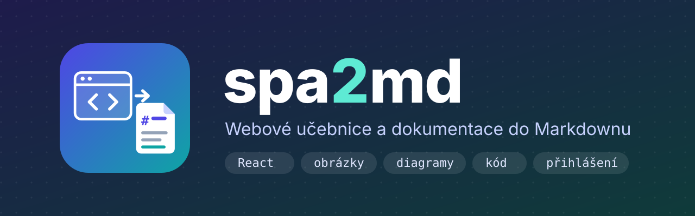

<p align="center"></p>

# spa2md

Stáhne online učebnici nebo dokumentaci **do Markdownu**: text, obrázky, diagramy i ukázky kódu. Zvládne i weby postavené v Reactu (a jiných SPA), které obsah vykreslují až JavaScriptem, a také weby za přihlášením (včetně Google OAuth).

```
https://web/kniha/...  ──►  ucebnice/
                              ├── index.md        obsah s odkazy na kapitoly
                              ├── kniha.md        celá kniha v jednom souboru
                              ├── 001_uvod.md
                              ├── 002_zakladni-pojmy.md
                              ├── ...
                              └── images/         obrázky a snímky diagramů
```

> 📘 Jsi začátečník? Krok za krokem od nuly: **[docs/NAVOD.md](docs/NAVOD.md)**

---

## Co umí

| Na webu je…                                   | V Markdownu z toho bude…                                   |
|-----------------------------------------------|------------------------------------------------------------|
| Text, nadpisy, seznamy, tabulky, odkazy       | Běžný Markdown                                             |
| Obrázky (i lazy-load, `srcset`, CSS pozadí)   | Stažený soubor v `images/` + ``        |
| Diagram (SVG, canvas, draw.io, HTML bloky)    | PNG snímek diagramu, popisek převzatý z textu pod ním      |
| Ukázka kódu s tlačítkem „Copy"                | ```` ```yaml ```` blok bez čísel řádků, se zachovaným odsazením |
| Menu, hlavička, patička                       | Vynecháno                                                  |
| Odkaz na jinou kapitolu                       | Relativní odkaz na její `.md` soubor                       |

## Rychlý start

```bash
git clone https://github.com/<uzivatel>/spa2md.git
cd spa2md
./install.sh                       # vytvoří .venv a nainstaluje závislosti
source .venv/bin/activate

python spa2md.py 'https://web.cz/kniha/uvod' -o kniha
```

Otevře se okno Chrome. Pokud je web za přihlášením, přihlas se, otevři první stránku knihy a v terminálu stiskni **Enter**. Skript pak sám projde všechny kapitoly.

> Adresu dávej do **jednoduchých uvozovek** `'…'`. Jinak shell zkomolí znaky `?` a `&`.

## Jak to funguje (polopatě)

Skript dělá to samé, co bys dělal ručně, jen automaticky a rychle:

1. **Otevře opravdový prohlížeč.** Moderní weby pošlou nejdřív prázdnou stránku a obsah do ní dopíše až JavaScript. Obyčejné stažení HTML (`curl`, `requests`) by vidělo jen tu prázdnou kostru. Proto skript ovládá Chrome přes knihovnu [Playwright](https://playwright.dev/python/) a čte stránku až ve chvíli, kdy je vykreslená.

2. **Využije tvoje přihlášení.** Prohlížeč má vlastní profil uložený ve složce `.browser-profile`. Přihlásíš se v něm jednou ručně a cookies tam zůstanou i pro další spuštění. Heslo skript nikdy nevidí.

3. **Prochází stránky jako pavouk.** Začne na zadané adrese a posbírá z ní odkazy. Ty, které vedou do stejné části webu (stejná „složka" v URL, viz `--scope`), si zařadí do fronty a postupně je navštíví. Každou stránku jen jednou.

4. **Na každé stránce nejdřív „uklidí":**
   - posune se až dolů, aby se načetly obrázky, které se nahrávají až při scrollování,
   - rozbalí sbalené části (`<details>`),
   - u **ukázek kódu** klikne na tlačítko kopírovat a zachytí text, který by šel do schránky (tvoje skutečná schránka zůstane netknutá). Když tlačítko chybí, zkusí text vytáhnout přímo z editoru (CodeMirror, Monaco, Ace) nebo ho složí řádek po řádku,
   - **diagramy** vyfotí jako PNG. Prohlížeč umí vyfotit jen konkrétní prvek stránky, takže výsledek vypadá přesně jako na webu.

5. **Najde, kde je skutečný obsah.** Menu je skoro celé z odkazů, článek je hlavně souvislý text. Skript proto vybere nejmenší blok stránky, ve kterém je většina textu, který *není* odkazem. Zbytky menu (bloky složené převážně z odkazů) pak ještě vyhodí.

6. **Převede HTML na Markdown** (knihovna [markdownify](https://github.com/matthewwithanm/python-markdownify)), stáhne obrázky přes tvoje přihlášení a přepíše odkazy tak, aby vedly na lokální soubory.

7. **Uloží výsledek.** Každá stránka dostane soubor `číslo_název.md` (číslo drží pořadí, název vzniká z titulku stránky). Vznikne i `index.md` s obsahem a `kniha.md` se vším v jednom souboru.

## Všechny přepínače

| Přepínač | K čemu |
|---|---|
| `-o SLOŽKA` | Kam uložit výsledek (výchozí `ucebnice_md`). |
| `--inspect` | Nic nestahuje. Jen vypíše, kde na první stránce leží obsah, a uloží `inspect.html`. Hodí se k ladění. |
| `--max-pages N` | Stáhne nejvýš N stránek. Na zkoušku použij `--max-pages 3`. |
| `--scope URL` | Stahovat jen adresy začínající tímto prefixem. Výchozí je „složka" startovní adresy. |
| `--selector CSS` | Ruční určení kontejneru s obsahem (když automatika netrefí). |
| `--remove CSS` | Prvky, které se mají z obsahu vyhodit. Lze opakovat. |
| `--links-selector CSS` | Odkud brát odkazy na další stránky, např. `"nav a[href]"`. |
| `--wait-for CSS` | Počkat, než se na stránce objeví tento prvek. |
| `--settle S` | Kolik sekund počkat na dorenderování (výchozí 1). |
| `--delay S` | Pauza mezi stránkami (výchozí 1 s, minimum 0,5 s). |
| `--diagram-selector CSS` | Další prvky, které se mají vyfotit jako obrázek. |
| `--scale N` | Ostrost snímků diagramů (výchozí 2 = retina). |
| `--no-code` / `--no-shots` | Vypne zpracování kódu / focení diagramů. |
| `--keep-link-blocks` | Nemazat bloky složené z odkazů. |
| `--profile SLOŽKA` | Kde držet profil prohlížeče (výchozí `.browser-profile`). |
| `--headless` | Bez okna. Jen když už jsi v profilu přihlášený. |
| `--no-login-prompt` | Nečekat na Enter před startem. |
| `--cdp URL` | Připojit se k už běžícímu Chrome (viz níže). |
| `--ignore-robots` | Nerespektovat `robots.txt`. Jen pro obsah, ke kterému máš právo. |
| `--stealth` | Skrýt příznaky automatizace v prohlížeči. Jen když se jinak nepřihlásíš (viz níže). |

### Když Google odmítne přihlášení

Google občas nepustí přihlášení v prohlížeči ovládaném automatizací. Doporučené řešení je spustit svůj Chrome se zapnutým ladicím portem, přihlásit se v něm normálně a skript k němu připojit:

```bash
# macOS
/Applications/Google\ Chrome.app/Contents/MacOS/Google\ Chrome \
  --remote-debugging-port=9222 --user-data-dir="$HOME/chrome-debug"

# potom v jiném terminálu
python spa2md.py 'https://…' --cdp http://localhost:9222
```

Alternativa je přepínač `--stealth`. Skryje, že prohlížeč řídí automatizace. Ve výchozím stavu je vypnutý, protože nástroj se má k webům chovat průhledně.

## Na jakých webech to funguje

Skript je **obecný**, ale ladil jsem ho hlavně na jedné e-learningové platformě postavené na Reactu. Realisticky:

✅ **Funguje dobře**
- dokumentace a online učebnice, kde jsou kapitoly propojené běžnými odkazy (`<a href>`),
- statické weby i SPA (React, Vue, Angular…),
- weby za přihlášením, do kterých se dostaneš v prohlížeči.

⚠️ **Může potřebovat doladění** (`--inspect`, `--selector`, `--remove`)
- stránky s neobvyklým rozvržením, kde automatika netrefí hlavní obsah,
- netypické code snippety nebo diagramy.

❌ **Nefunguje**
- navigace jen klikáním na tlačítka bez skutečných odkazů (skript další stránky nenajde),
- obsah uvnitř `<iframe>`, nekonečné scrollování, videa, PDF přílohy,
- weby s ochranou proti botům (Cloudflare challenge apod.).

Diagramy jsou obrázky, ne upravitelný text.

## Řešení problémů

| Problém | Řešení |
|---|---|
| Výsledné `.md` obsahují jen menu | Spusť `--inspect` a vezmi selektor z výpisu: `--selector "…"`. |
| Chybí část obsahu | Zvyš `--settle 3` nebo použij `--wait-for "css-prvku-s-obsahem"`. |
| HTTP 400 / 404 hned na první stránce | Zkontroluj adresu. Používej jednoduché uvozovky a žádné `\` v URL. |
| Stáhne se jen jedna stránka | Odkazy na kapitoly nejsou `<a href>`, nebo jsou mimo `--scope`. |
| Google hlásí „Tento prohlížeč není bezpečný" | Použij režim `--cdp` (viz výše). |
| „robots.txt tohoto webu … zakazuje" | Web si nepřeje automatické procházení. Pokud jde o obsah, ke kterému máš právo, použij vědomě `--ignore-robots`. |
| Diagram je oříznutý nebo zabírá celou stránku | Urči ho přesně přes `--diagram-selector`. |
| Varování `Permissions-Policy … Unrecognized feature` | Neškodná hláška Chrome, ignoruj ji. |

## Zodpovědné používání

spa2md je navržený tak, aby se k webům choval slušně:

- **Respektuje `robots.txt`.** Stránky, které web zakazuje automaticky procházet, přeskočí.
- **Dělá pauzy** mezi stránkami (výchozí 1 s, nejméně 0,5 s), aby server zbytečně nezatěžoval.
- **Nic neobchází.** Vidí jen to, k čemu máš přístup ve vlastním prohlížeči s vlastním přihlášením. Neprolamuje DRM, šifrování ani přístupová práva a ve výchozím stavu nijak neskrývá, že prohlížeč řídí automatizace.
- **Označí původ.** Do `index.md` a `kniha.md` zapíše zdroj, datum stažení a upozornění, že obsah patří autorům.

Za to, co stahuješ a jak to použiješ, odpovídáš ty:

- Stahuj jen obsah, ke kterému máš přístup a právo, typicky pro vlastní studium. Česká právní úprava povoluje kopii pro osobní potřebu fyzické osoby, ne její další šíření.
- Stažený obsah **nezveřejňuj** a **necommituj** do repozitáře (`.gitignore` výstupy ignoruje).
- Respektuj podmínky užívání webu. Některé platformy automatizovaný přístup zakazují.
- Nestahuj stránky s osobními údaji jiných lidí (GDPR).
- Složka `.browser-profile` obsahuje tvoje přihlašovací cookies. **Nikdy ji nesdílej** (je v `.gitignore`).

> Tento software se poskytuje „tak, jak je", bez záruky (viz licence). Nejde o právní radu. Autor nenese odpovědnost za způsob, jakým ho kdo použije.

## Licence

MIT, viz [LICENSE](LICENSE).
